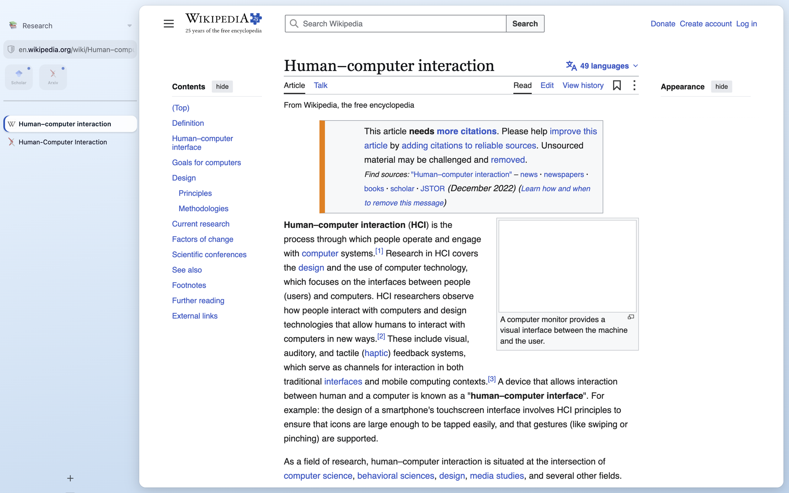
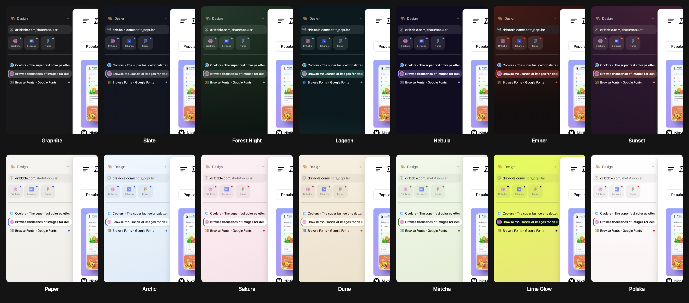

# Vivaldi Arcify (it, finally)

**Make Vivaldi look and work like Arc.** For macOS.


## Install

1. Install [Vivaldi](https://vivaldi.com) and open it once.
2. Paste this in Terminal:

```sh
curl -fsSL https://raw.githubusercontent.com/SashaGo3/vivaldi-arcify-it-finally/main/install.sh | zsh
```

3. A settings page opens in Vivaldi. Pick your themes, then click
   **Apply and restart Vivaldi**. Your tabs come back.

Keep the Terminal window open until you're done.

## Commands

| Command | What it does |
|---|---|
| `arcify ui` | Open the settings page |
| `arcify setup` | Set up in the terminal instead (add `--yes` to use the defaults) |
| `arcify update` | Get the newest version and apply it |
| `arcify reload` | Apply changes to the JS mods without quitting Vivaldi |
| `arcify status` | Show what is on |
| `arcify themes` | List the themes |
| `arcify set defaultTheme=Slate` | Change a setting, then `arcify apply` |
| `arcify workspace Work --theme Slate` | Give a workspace a theme, then `arcify apply` |
| `arcify config` | Open your config file |
| `arcify uninstall` | Remove the mods (`--all` also deletes your config) |

**AI agents:** see [AGENTS.md](AGENTS.md). Every command has a no-questions
form, and `status`, `themes` and `get` print JSON.

No `arcify` command? Use the full path:
`~/Library/Application\ Support/VivaldiArcify/app/arcify`

## What you get

| | |
|---|---|
|  |  |
|  |  |

- **Arc layout.** The page floats with rounded corners. No top bar. The
  address field is in the sidebar.
- **Pinned tabs as a grid** at the top of the sidebar.
- **A theme for each workspace.** It changes when you change workspace.
- **14 themes**, 7 dark and 7 light, checked for contrast.
- **A tidy tab list.** Shorter titles. Old tabs and duplicates are dimmed.
  **Clear** closes them, with Undo. Idle tabs are unloaded.
- **Site stacks.** 3 or more tabs from one site become a stack.
- **Panel dock.** Panel icons show in a row when you hover the bottom of the
  sidebar.
- **Back closes link tabs.** Cmd+[ on a new tab from a link closes it.
- **Optional:** reinstall after Vivaldi updates, settings in iCloud Drive,
  pinned tabs synced between your Macs.



**To change a workspace's theme:** go to the workspace and pick a theme in
Settings > Themes (or Cmd+E, then type the name). It stays with that
workspace.

## Good to know

- **Vivaldi updates remove the JS mods.** Turn on "Reinstall after Vivaldi
  updates", or run `arcify reload` after an update.
- **macOS may ask for App Management permission** for Terminal the first
  time. This lets the mods go into Vivaldi.app.
- **Nothing is deleted.** Setup only adds or updates. It keeps a backup of
  Vivaldi's settings as `Preferences.bak-arcify`.

## More

- [docs/guide.md](docs/guide.md): how it works, the config file, pinned tab
  sync, and setup by hand.
- [docs/themes.md](docs/themes.md): make your own theme.
- [docs/troubleshooting.md](docs/troubleshooting.md): when something looks
  wrong.

## Credits

The frame builds on **[VivalArc](https://github.com/tovifun/VivalArc)** by
tovifun. Setup downloads VivalArc 1.1.0 from its repo. It isn't copied here
because it has no license file. [`css/vivalarc-tweaks.css`](css/vivalarc-tweaks.css)
holds our changes on top.

Not affiliated with Vivaldi Technologies or The Browser Company. Arc is
their browser; this just borrows the idea.

## License

[MIT](LICENSE) for everything in this repo. VivalArc stays under its
author's terms.
